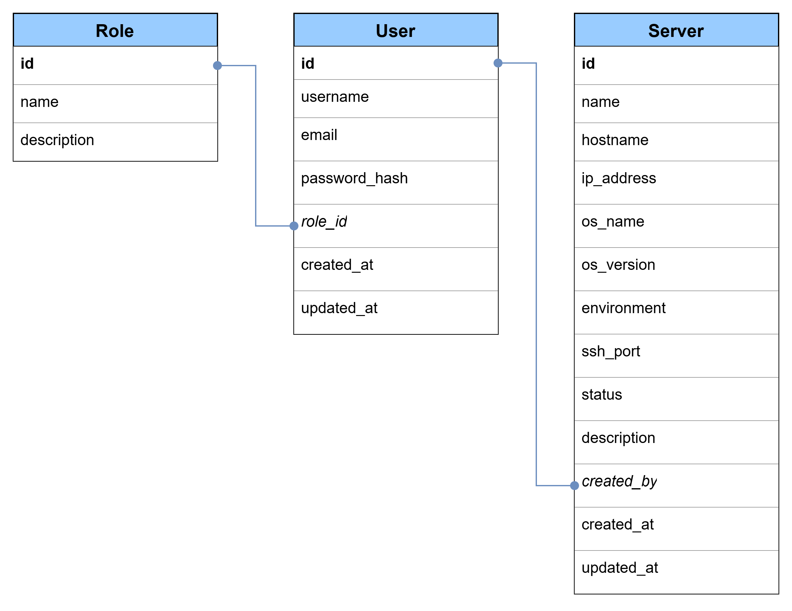

# Organización de la base de datos

# Convención de nombres
### ID
id SERIAL PRIMARY KEY

### username
VARCHAR(50)

### email
VARCHAR(255)

### role.name
VARCHAR(30)

### server.name
VARCHAR(100)

### hostname
VARCHAR(255)

### created_at
TIMESTAMP

### updated_at
TIMESTAMP

# Estrcutura
### Tablas
roles
users
servers

minusculas, plural y snake_case
### Columnas
snake_case

# Tablas
### Roles
roles

id
name
description
created_at

### Users
users

id
username
email
password_hash

role_id

created_at
updated_at

### Servers
servers

id

name
hostname
ip_address

os_name
os_version

environment
status

description

created_by

created_at
updated_at

# Relaciones
users.role_id --> roles.id

servers.created_by --> user.id

email --> UNIQUE
username --> UNIQUE
ip_address --> UNIQUE

# Restricciones
### Environment
Solo permitiremos:
- development
- preproduction
- production

### status
- online
- offline
- unknown
